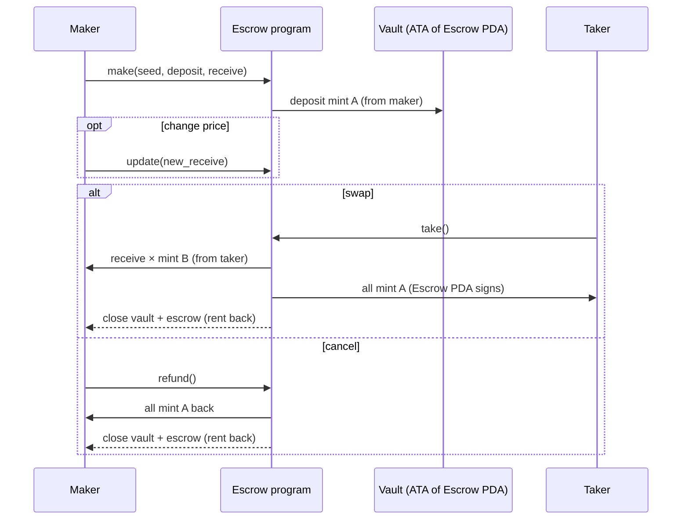
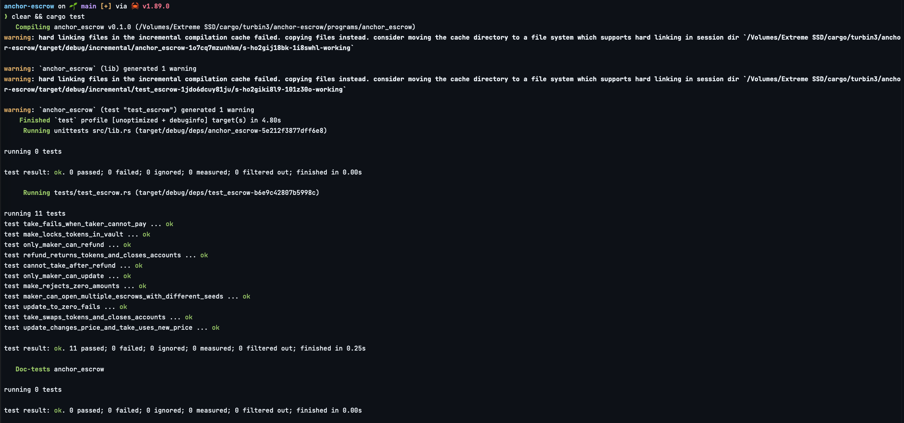

# Anchor Escrow

A trustless token swap on Solana, built with Anchor 1.1.2 and tested with [LiteSVM](https://github.com/LiteSVM/litesvm).

A **maker** locks some of token A and states how much of token B they want in exchange. Anyone (a **taker**) can complete the swap in one atomic transaction. Until then, the maker can change the price or cancel and get their tokens back. No third party ever holds the funds: the program does.

## Instructions

| Instruction | Signer | What it does |
|---|---|---|
| `make(seed, deposit, receive)` | maker | Creates the `Escrow` PDA and a vault token account owned by it, then moves `deposit` of mint A from the maker into the vault. |
| `take()` | taker | Sends `receive` of mint B from taker to maker, releases the whole vault (mint A) to the taker, closes the vault and the escrow, and returns all rent to the maker. Creates the taker's / maker's ATAs if missing. |
| `refund()` | maker | Returns the vaulted mint A to the maker and closes the vault and escrow. |
| `update(new_receive)` | maker | Changes how much mint B the maker wants. |

## Accounts

```
Escrow PDA   seeds = ["escrow", maker, seed.to_le_bytes()]
├── seed: u64        // lets one maker run many escrows in parallel
├── maker: Pubkey
├── mint_a: Pubkey   // token deposited
├── mint_b: Pubkey   // token wanted
├── receive: u64     // amount of mint_b wanted
└── bump: u8

Vault        = ATA(mint_a, authority = Escrow PDA)
```



## Security checks

- The escrow is re-derived from its seeds plus a `has_one = maker / mint_a / mint_b` check on `take` and `refund`, so the wrong mints or someone else's escrow can't be passed in.
- `refund` and `update` need the maker to sign, and the PDA seeds include the signer's key.
- `transfer_checked` checks the mint and its decimals on every transfer.
- Amounts of zero and `mint_a == mint_b` are rejected.
- Uses `token_interface`, so it works with both SPL Token and Token-2022 mints.
- Token accounts are `Box`ed to stay inside the 4 KB stack frame.

## Tests (LiteSVM, Rust)

`programs/anchor_escrow/tests/test_escrow.rs`: 11 tests.

| Test | Covers |
|---|---|
| `make_locks_tokens_in_vault` | make: state fields + vault balance |
| `take_swaps_tokens_and_closes_accounts` | take: both legs of the swap, ATAs created on the fly, accounts closed, rent back to maker |
| `refund_returns_tokens_and_closes_accounts` | refund: maker made whole, accounts closed |
| `update_changes_price_and_take_uses_new_price` | update then take at the new price |
| `update_to_zero_fails` | update validation |
| `only_maker_can_update` | access control on update |
| `only_maker_can_refund` | access control on refund |
| `take_fails_when_taker_cannot_pay` | taker short on mint B, so nothing moves |
| `cannot_take_after_refund` | closed escrow can't be taken |
| `make_rejects_zero_amounts` | make validation |
| `maker_can_open_multiple_escrows_with_different_seeds` | seed-based PDAs; duplicate seed rejected |

All tests passing:



## Run it

```bash
anchor build   # compiles the .so into target/deploy
anchor test    # runs `cargo test` against the built program in LiteSVM
```

Requires Anchor CLI 1.1.2, Solana CLI 3.x and Rust (toolchain pinned in `rust-toolchain.toml`).
